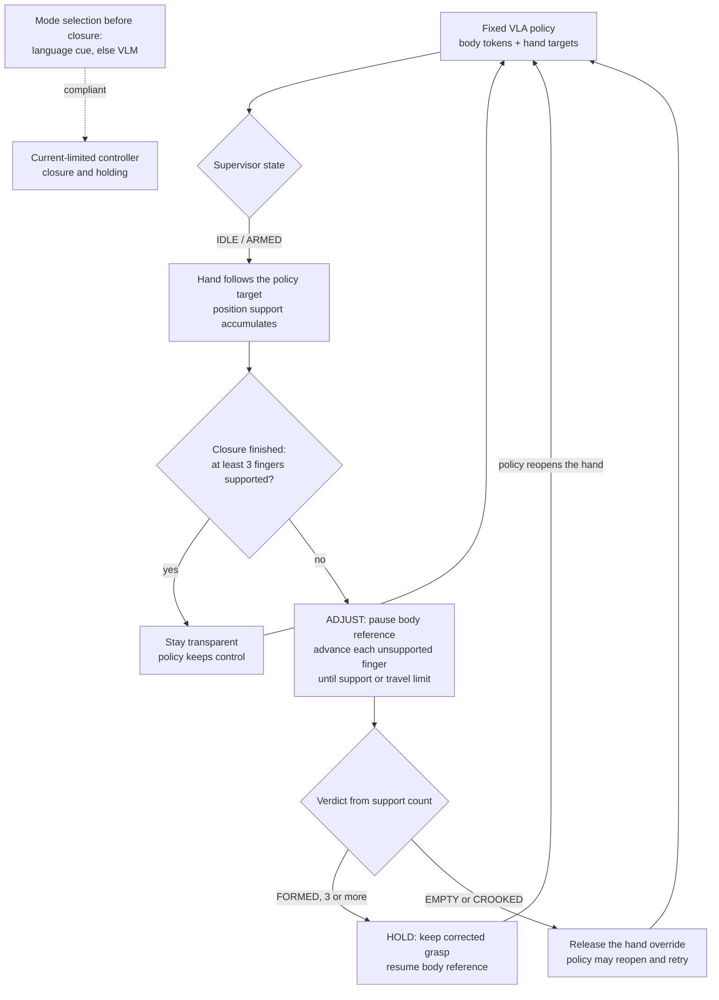

# AgenticTactileVLA

Contact-guided execution-time supervision for a fixed vision-language-action
(VLA) policy on a humanoid robot with a dexterous hand.

> **Status of this code.** `src/` is a reimplementation from the paper
> specification. It was assembled without the deployed supervisor code, which
> was not available, and it has not been re-run on hardware. The robot bridge
> (`src/agentic_tactile_vla/bridge/`) and the compliant hand service
> (`drivers/brainco_compliant/`) are adapted from files recovered from the
> robot; their connection to the reimplemented supervisor is new and equally
> untested on hardware.

## 1. What this is

A VLA policy can choose the right way to grasp an object and still fail to
carry it out: fingers stop short of the surface, the final hand shape does not
hold the object, or a fragile object is crushed. During closure the hand hides
the contact region from the camera, so the policy cannot see the problem.

AgenticTactileVLA keeps the policy fixed and adds a supervisor that runs while
the policy executes. The policy predicts the grasp strategy. The supervisor
checks whether that strategy has been physically realized, using only the
finger positions and motor effort the hand already reports. If the grasp is
not supported, it pauses the body motion, closes each finger individually
until that finger meets resistance, and then either keeps the corrected grasp
or hands the hand back to the policy for another attempt. It needs no tactile
sensors and no retraining of the policy.

Platform: Unitree G1 humanoid, BrainCo Revo2 hand, GR00T-N1.6-3B policy,
GEAR-SONIC whole-body controller.

## 2. Headline results

All numbers in this section are quoted from the paper (`paper/`). They were
obtained with the deployed system, not with the code in this repository.

Five held-out objects, 15 matched trials each, shared execution budget.

| Condition | Completion | 95% CI |
|---|---|---|
| Base VLA | 61.3% (46/75) | 50.0–71.5 |
| VLA + unconditional close-to-stall | 72.0% (54/75) | 61.0–80.9 |
| **Supervisor** | **84.0% (63/75)** | 74.1–90.6 |

The supervisor beats the base VLA (Holm-corrected p = 0.001) and unconditional
close-to-stall control (p = 0.045). Close-to-stall alone does not significantly
beat the base VLA (p = 0.077).

Component ablation, 100 matched blocks:

| Variant | What it is | Completion | Corrections |
|---|---|---|---|
| U-stall | every closure, position stall only | 72% | 135 |
| U-full | every closure, full detector and verdict | 84% | 134 |
| S-position | selective, no effort evidence | 79% | 49 |
| S-retain | selective, no verdict-dependent release | 77% | 47 |
| S-full | complete supervisor | 86% | 46 |

S-full against U-stall is significant (p = 0.047). Several contrasts are not
statistically resolved: U-full against U-stall (p = 0.091), and S-full against
S-position and S-retain (p = 0.378 and 0.235). Selectivity cuts correction
episodes by 65.7% with no detected change in completion (p = 0.804); that is
absence of a detected difference, not shown equivalence.

Thin-walled cup, five trials per condition:

| Mode selected by | Intact | Damaged | Compliant active |
|---|---|---|---|
| No selection (position control) | 0 | 5 | 0/5 |
| Instruction cue | 5 | 0 | 5/5 |
| VLM from image | 4 | 1 | 4/5 |
| Instruction + VLM | 5 | 0 | 5/5 |
| Always compliant | 5 | 0 | 5/5 |

Always-compliant control does equally well, so this shows that routing works,
not that routing is better. The cup is a training object.

## 3. How it works



**State machine.** Four states. `b_t = 1` pauses progression of the body
reference; whole-body stabilization stays active.

| State | `b_t` | Hand override | Exit |
|---|---|---|---|
| IDLE | 0 | no | a closure is coming up in the action chunk |
| ARMED | 0 | no | the policy has finished its closure |
| ADJUST | 1 | yes | verdict or timeout |
| HOLD | 0 | yes | the policy reopens the hand |

**Selective intervention.** The supervisor decides only once per closure, at
the moment the policy has finished closing. With at least three supported
fingers it does nothing. Before that moment missing contact is expected and
triggers nothing.

**Detector.** For each of the five flexion channels the detector compares
commanded and measured motion over a 0.25 s window. A finger whose command
advances while its position does not is stalled. Inside ADJUST, a sustained
change in motor effort combined with incomplete tracking also counts. Either
one latches support for that finger. Motor effort is a device-specific
indicator of resistance, not calibrated force.

**Correction.** Each unsupported finger advances from its measured position in
steps of 0.004 every 20 ms. When its support latches, its reference is fixed at
the measured position plus a preload of 0.02. Thumb opposition is never
changed. ADJUST lasts between 0.6 s and 4.0 s.

**Verdict.** FORMED with three or more supports, EMPTY with none, CROOKED
otherwise. CROOKED means insufficient support evidence, not geometric
misalignment.

**Mode selection.** "gently", "carefully" or "fragile" in the instruction
selects compliant control. Otherwise Qwen2.5-VL-7B-Instruct picks one of the
two modes from the camera image while the hand is still open. Language cues
win; a missing, late or malformed VLM reply means nominal control. The VLM
outputs only a mode label.

Details: [docs/architecture.md](docs/architecture.md),
[docs/detector.md](docs/detector.md).

## 4. Hardware and software requirements

| Item | Requirement |
|---|---|
| Robot | Unitree G1 humanoid |
| Hand | BrainCo Revo2, six motor channels, positions normalized to [0, 1], no touch sensors |
| Policy | GR00T-N1.6-3B fine-tuned on teleoperated demonstrations, served by the Isaac-GR00T policy server |
| Whole-body control | GEAR-SONIC (GR00T-WholeBodyControl) |
| VLM, optional | Qwen2.5-VL-7B-Instruct on a GPU server |
| Python | 3.10 or newer |
| Core package | `numpy` |
| Robot side | `pyzmq`, `msgpack`, `tyro`, `opencv-python`, plus `gear_sonic` and `unitree_sdk2py` from their own repositories |
| Compliant hand service | C++17 compiler, CMake, the BrainCo Stark SDK |
| VLM service | `torch`, `transformers`, `accelerate`, `pillow`, `pyzmq` |
| Analysis | `pandas`, `matplotlib` |

The supervisor logic, the tests and the analysis scripts run on any computer.
Only the bridge needs the robot.

## 5. Installation

```bash
git clone <repository url>
cd agentic-tactile-vla
python -m venv .venv && source .venv/bin/activate
pip install -e ".[analysis,dev]"
pytest
```

On the robot, inside the GR00T-WholeBodyControl data-collection environment:

```bash
pip install -e ".[robot]"
cp .env.example .env    # fill in the addresses, then: set -a; source .env; set +a
```

On the GPU server, for the VLM service: `pip install -e ".[vlm]"`.

## 6. Running it

Start the processes in this order. Full details and troubleshooting are in
[docs/deployment.md](docs/deployment.md).

**Step 1, policy server (GPU server). Wait for "Server is ready".**

```bash
python gr00t/eval/run_gr00t_server.py --model-path <checkpoint> \
  --embodiment-tag NEW_EMBODIMENT --port 5555
```

**Step 2, port forward (GPU server host), only if the server runs in a container.**

```bash
socat TCP-LISTEN:5555,fork,reuseaddr TCP:<container address>:5555
```

**Step 3, camera (robot).**

```bash
python -m gear_sonic.camera.composed_camera --ego-view-camera usb \
  --ego-view-device-id <video device id> --port $CAMERA_PORT
```

**Step 4, hand service (robot). Exactly one instance.**

```bash
sudo ./bin/brainco_hand_server -n $HAND_IFACE
```

**Step 5, whole-body controller (robot). Wait for "Init done". The robot stands up.**

```bash
cd ~/GR00T-WholeBodyControl/gear_sonic_deploy && source scripts/setup_env.sh
./deploy.sh --input-type zmq_manager real
```

**Step 6, keyboard publisher (robot).**

```bash
python scripts/keyboard_publisher.py
```

**Step 7, bridge with the supervisor (robot). Wait for "PolicyServer is reachable".**

```bash
HAND_ENABLE=1 SLEW_ENABLE=1 python scripts/run_agent.py --hand left \
  --embodiment-tag NEW_EMBODIMENT --prompt "pick up the object and place it down"
```

Then press `k`, `i`, `p` in the keyboard publisher. Use `--no-agent` for the
base VLA and `--observe` to log supervisor decisions without acting on them.

## 7. Configuration

All thresholds live in [`src/agentic_tactile_vla/config.py`](src/agentic_tactile_vla/config.py).

| Parameter | Paper symbol | Default | Controls |
|---|---|---|---|
| `control_period` | 50 Hz | 0.02 s | rate of finger references |
| `arm_delta`, `arm_window` | | 0.015, 0.25 s | flexion-target advance that arms a closure |
| `terminal_delta`, `terminal_window` | | 0.005, 0.12 s | target variation below which the closure is finished |
| `min_support` | 3 in eqs. (3), (8) | 3 | supports needed to stay transparent and for FORMED |
| `window` | W | 0.25 s | detector history window |
| `delta_u` | δ_u | 0.015 | minimum commanded advance over W |
| `rho_s` | ρ_s | 0.3 | tracking ratio for position stall |
| `rho_d` | ρ_d | 0.7 | tracking ratio for the effort-duration test |
| `delta_e` | δ_e | 0.3 | effort deviation from the ADJUST baseline, device units |
| `t_e` | T_e | 0.06 s | required duration of the effort deviation |
| `step`, `step_period` | | 0.004, 0.02 s | correction increment |
| `preload` | | 0.02 | added to the measured position when support latches |
| `min_adjust`, `max_adjust` | | 0.6 s, 4.0 s | bounds on the adjustment phase |
| `reopen_delta`, `reopen_hold` | | 0.05, 0.12 s | drop in mean flexion that releases a hold and allows rearming |
| `travel_limit` | permitted travel limit | 0.98 on flexion channels | upper bound of each finger reference; not reported in the paper, taken from the teleoperation closed-hand preset |
| `selective`, `use_effort`, `verdict_release`, `use_verdict` | S / U variants | all true | ablation switches |
| `CompliantConfig.kp`, `kd` | K_p, K_d | 5.0, 0.05 | controller-interface gains, not stiffness or damping |
| `CompliantConfig.period` | | 0.02 s | compliant loop period |
| `CompliantConfig.i_max` | I_max | 0.15 | normalized command limit; raw 150 → 0.15, raw 200 → 0.20; not calibrated current |
| `CompliantConfig.velocity_alpha` | | 0.3 | velocity smoothing factor; not reported in the paper |
| `CompliantConfig.target` | q_d | per channel | predefined grasp configuration; not reported in the paper |
| `ModeConfig.handling_cues` | | gently, carefully, fragile | words that select compliant mode |

Detector thresholds were selected from 40 calibration closures on the five
training objects and frozen before evaluation. Do not tune them on evaluation
objects.

## 8. Repository layout

```
agentic-tactile-vla/
├── src/agentic_tactile_vla/   library: supervisor, detector, correction, verdict, modes, compliant control, hand interface
│   └── bridge/                robot-side integration with the GR00T bridge, policy client, patch notes
├── scripts/                   entry points: robot launcher, keyboard publisher, VLM service, log replay
│   └── figures/               figure script that reads the recorded logs
├── analysis/                  statistics from the published counts, eq. (8) on recorded flags, retention audit
├── drivers/brainco_compliant/ current-mode hand service for the compliant branch (C++), gate diagnostics, clients
├── configs/                   GR00T modality config used for fine-tuning
├── tests/                     unit tests on a simulated finger model
├── data/raw/                  August development logs, unchanged
├── data/processed/            per-attempt and summary tables from the same sessions
├── docs/                      architecture, detector, deployment, experiments, data formats
└── paper/                     paper PDF and LaTeX source
```

## 9. Reproducing the analysis

Per-trial records for the evaluation tables are not part of this release.
`data/raw/` contains August development logs recorded with an earlier version
of the supervisor; they document the log format and can be replayed through
the detector, but do not reproduce the paper's tables.

What can be run:

| Command | What it gives |
|---|---|
| `python analysis/paper_statistics.py` | Wilson intervals, exact McNemar and Holm p-values and derived rates for Tables II to V, computed from the counts printed in the paper |
| `python analysis/retention_audit.py --counts 70 6 18 26` | rates of the retention table from its four cells |
| `python analysis/compute_verdicts.py data/raw/verdicts_left_*.csv` | the verdict rule of eq. (8) applied to the recorded per-finger flags |
| `python scripts/replay_logs.py data/raw/ramp_left_*.csv` | the detector of this repository replayed over recorded correction episodes |
| `python scripts/figures/fig_event.py data/raw/ramp_left_20260819_022049.csv -a 9` | plot of one recorded correction event |
| `pytest` | unit tests of the state machine, detector, correction, mode selection and compliant law |

How each table was produced is described in
[docs/experiments.md](docs/experiments.md).

## 10. Limitations

* **Proprioception is not calibrated force.** Positions and motor effort are
  device-specific signals. Thresholds do not transfer to another hand without
  recalibration.
* **Highly compliant objects defeat the motion-based cue.** The soft ball
  produced zero FORMED verdicts in six correction events although it was
  physically enclosed every time.
* **Rejection is conservative.** In the retention audit the NPV is 59.1%
  pooled, and on held-out objects 25.6% of retainable configurations were
  falsely rejected. Acceptance is the reliable direction.
* **The fragile-object study used a training object.** It does not show
  held-out fragile-object generalization, and routing did not beat
  always-compliant control.
* **Compliant control covers static grasping only.** Closure and holding, no
  autonomous transport.
* **The supervisor cannot recover from arbitrary approach errors.** It adapts
  a feasible policy-generated grasp; it does not replace the approach.
* **Some effects are not statistically resolved.** The separate contributions
  of effort evidence and verdict-dependent release are not isolated by the
  ablation, and no difference between selective and always-on supervision was
  detected, which is not proof of equivalence.
* **This code has not been run on the robot.** See the status note at the top.
  The compliant hand service in `drivers/` needs gate files recorded on your
  own hand before it starts, and it contains safety logic beyond equation (9),
  such as a closing-speed cap, that the paper does not describe.

## 11. Citation

```bibtex
@misc{semenyakina2026agentictactilevla,
  title  = {AgenticTactileVLA: Contact-Guided Execution-Time Supervision for
            Generalizable Dexterous Manipulation without VLA Retraining},
  author = {Semenyakina, Elizaveta and Snegirev, Ivan and Kiselev, Mikhail and
            Altamirano Cabrera, Miguel and Lykov, Artem and Amjad, Hajira and
            Tsetserukou, Dzmitry},
  year   = {2026},
  note   = {Manuscript}
}
```

## License

MIT, see [LICENSE](LICENSE). The bridge file derived from
GR00T-WholeBodyControl stays under Apache-2.0; see
[src/agentic_tactile_vla/bridge/NOTICE](src/agentic_tactile_vla/bridge/NOTICE).
