# AgenticTactileVLA

An execution-time supervisor that lets a fixed vision-language-action (VLA)
policy finish its grasps on a humanoid hand, using only finger positions and
motor effort.

<p align="center">
  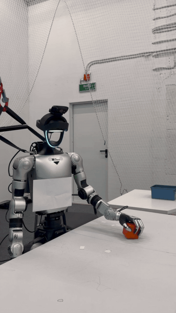
  <br>
  <em>Supervised pick-and-place of the cube, an object held out from VLA training. Real time, trimmed to 8 s.</em>
</p>

> **Status of this code.** `src/` is a reimplementation from the paper
> specification. It was assembled without the deployed supervisor code, which
> was not available, and it has not been re-run on hardware. The robot bridge
> (`src/agentic_tactile_vla/bridge/`) and the compliant hand service
> (`drivers/brainco_compliant/`) are adapted from files recovered from the
> robot; their connection to the reimplemented supervisor is new and equally
> untested on hardware.

## 1. What this is

A VLA policy can choose the right way to grasp an object and still fail to
carry it out: fingers stop short of the surface, the final hand shape does not
hold the object, or a fragile object is crushed. During closure the hand hides
the contact region from the camera, so the policy cannot see the problem.

AgenticTactileVLA keeps the policy fixed and adds a supervisor that runs while
the policy executes. The policy predicts the grasp strategy. The supervisor
checks whether that strategy has been physically realized, using only the
finger positions and motor effort the hand already reports. If the grasp is
not supported, it pauses the body motion, closes each finger individually
until that finger meets resistance, and then either keeps the corrected grasp
or hands the hand back to the policy for another attempt. It needs no tactile
sensors and no retraining of the policy.

<p align="center">
  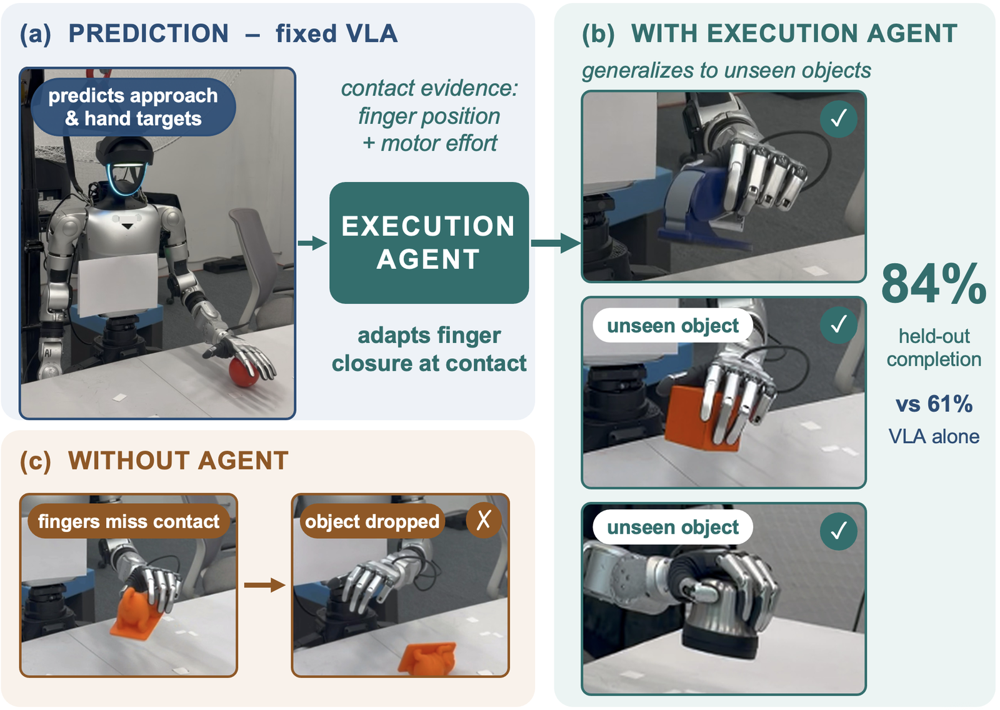
  <br>
  <em>From VLA prediction to execution-time physical adaptation (Fig. 1 of the paper).</em>
</p>

Platform: Unitree G1 humanoid, BrainCo Revo2 hand, GR00T-N1.6-3B policy,
GEAR-SONIC whole-body controller.

## Quick start (no robot needed)

The supervisor logic, the recorded logs and the analysis run on any computer
with Python 3.10 or newer.

```bash
git clone https://github.com/eliizavetas/agentic-tactile-vla.git
cd agentic-tactile-vla
python3 -m venv .venv && source .venv/bin/activate
pip install -e ".[analysis,dev]"
pytest
python scripts/replay_logs.py data/raw/ramp_left_20260819_022049.csv
python analysis/paper_statistics.py
python scripts/figures/fig_event.py data/raw/ramp_left_20260819_022049.csv -a 9
```

| Command | What you should see |
|---|---|
| `git clone`, `cd` | a download of about 55 MB that unpacks to about 190 MB, most of it recorded logs |
| `python3 -m venv`, `source` | a fresh virtual environment, active in this shell |
| `pip install` | the package with its analysis and test dependencies; no errors |
| `pytest` | `58 passed` |
| `replay_logs.py` | a table of 58 recorded correction episodes, each with the support count and verdict this detector gives on the logged signals |
| `paper_statistics.py` | the paper's intervals and p-values recomputed from its published counts, starting with `Base VLA 46/75 = 61.3%` |
| `fig_event.py` | per-finger lines for episode 9 and `wrote fig_event.pdf / .png` in the current directory |

Running on a robot needs the hardware and the external software listed under
"Running it".

## 2. Results

All numbers in this section are quoted from the paper (`paper/`). They were
obtained with the deployed system, not with the code in this repository.

Five held-out objects, 15 matched trials each, shared execution budget.

| Condition | Completion | 95% CI |
|---|---|---|
| Base VLA | 61.3% (46/75) | 50.0–71.5 |
| VLA + unconditional close-to-stall | 72.0% (54/75) | 61.0–80.9 |
| **Supervisor** | **84.0% (63/75)** | 74.1–90.6 |

The supervisor beats the base VLA (Holm-corrected p = 0.001) and unconditional
close-to-stall control (p = 0.045). Close-to-stall alone does not significantly
beat the base VLA (p = 0.077).

Same object, same start, with and without supervision (thermos lid, held out):

<table>
  <tr>
    <td align="center">
      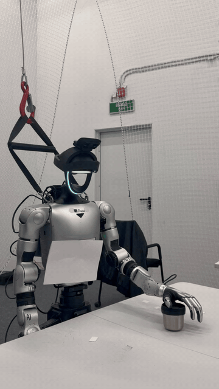
      <br><em>Base VLA: the lid is lifted and dropped. 0.5x speed.</em>
    </td>
    <td align="center">
      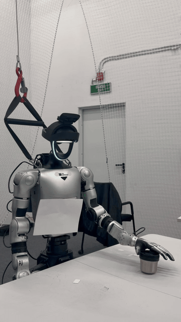
      <br><em>VLA + supervisor: the lid is carried and placed. Real time.</em>
    </td>
  </tr>
</table>

In the base run the lid is lifted and then slips out of the hand. With the
supervisor, the same object from the same starting position is carried and
placed. The next pair shows another held-out object and, for comparison, a
training object:

<table>
  <tr>
    <td align="center">
      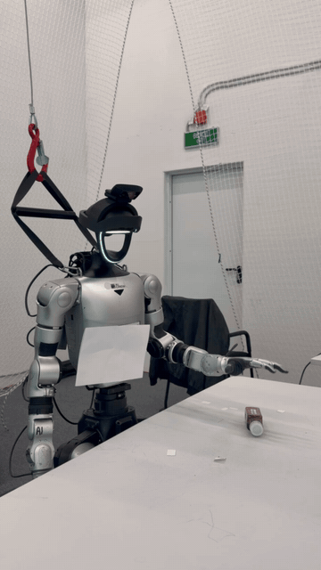
      <br><em>Soy sauce bottle (held out), with the supervisor. Real time, trimmed to 8 s.</em>
    </td>
    <td align="center">
      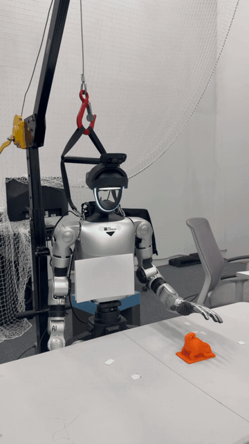
      <br><em>Toy (training object), with the supervisor. Real time, trimmed to 8 s.</em>
    </td>
  </tr>
</table>

The clips are single illustrative runs. The numbers come from the tables.

Component ablation, 100 matched blocks:

| Variant | What it is | Completion | Corrections |
|---|---|---|---|
| U-stall | every closure, position stall only | 72% | 135 |
| U-full | every closure, full detector and verdict | 84% | 134 |
| S-position | selective, no effort evidence | 79% | 49 |
| S-retain | selective, no verdict-dependent release | 77% | 47 |
| S-full | complete supervisor | 86% | 46 |

S-full against U-stall is significant (p = 0.047). Several contrasts are not
statistically resolved: U-full against U-stall (p = 0.091), and S-full against
S-position and S-retain (p = 0.378 and 0.235). Selectivity cuts correction
episodes by 65.7% with no detected change in completion (p = 0.804); that is
absence of a detected difference, not shown equivalence.

## 3. How it works

<p align="center">
  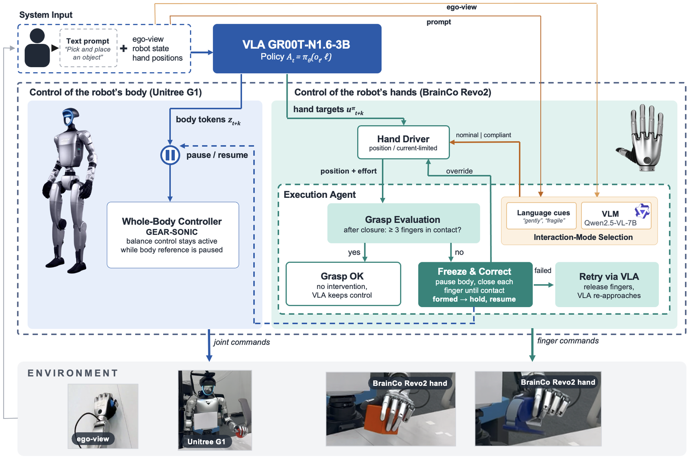
  <br>
  <em>System architecture (Fig. 2 of the paper).</em>
</p>

The fixed VLA sends body-motion tokens to the GEAR-SONIC whole-body controller
and hand targets to the hand driver. The execution agent sits on the hand path.
It reads finger positions and motor effort, evaluates the grasp once the policy
has finished closing, and then either leaves control with the policy or pauses
the body reference and corrects the fingers. If the corrected grasp is
rejected, the fingers are released and the policy approaches again. Before the
hand closes, language cues and the VLM choose between position control and
current-limited compliant control.


**Selective intervention.** The supervisor decides only once per closure, at
the moment the policy has finished closing. With at least three supported
fingers it does nothing. Before that moment missing contact is expected and
triggers nothing.

**Detector.** For each of the five flexion channels the detector compares
commanded and measured motion over a 0.25 s window. A finger whose command
advances while its position does not is stalled. Inside ADJUST, a sustained
change in motor effort combined with incomplete tracking also counts. Either
one latches support for that finger. Motor effort is a device-specific
indicator of resistance, not calibrated force.

**Correction.** Each unsupported finger advances from its measured position in
steps of 0.004 every 20 ms. When its support latches, its reference is fixed at
the measured position plus a preload of 0.02. Thumb opposition is never
changed. ADJUST lasts between 0.6 s and 4.0 s.

**Verdict.** FORMED with three or more supports, EMPTY with none, CROOKED
otherwise. CROOKED means insufficient support evidence, not geometric
misalignment.

**Mode selection.** "gently", "carefully" or "fragile" in the instruction
selects compliant control. Otherwise Qwen2.5-VL-7B-Instruct picks one of the
two modes from the camera image while the hand is still open. Language cues
win; a missing, late or malformed VLM reply means nominal control. The VLM
outputs only a mode label.

<details>
<summary>State machine: IDLE / ARMED / ADJUST / HOLD and the compliant branch</summary>

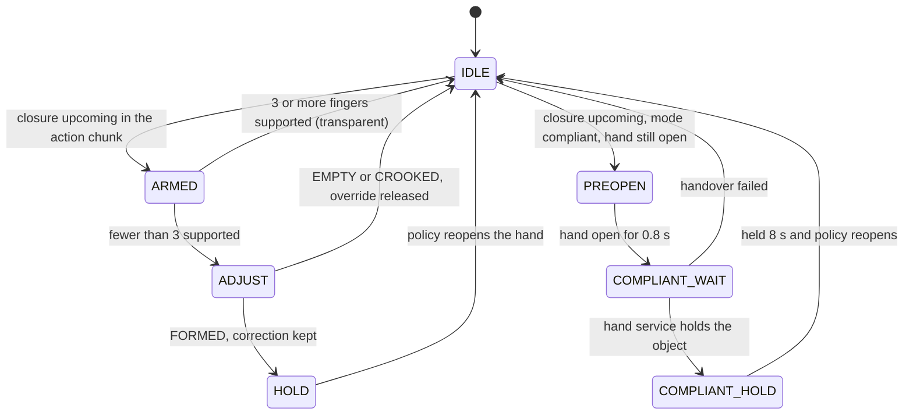

**State machine.** Four states on the position path and three in the compliant
branch, which is described under "Fragile objects". `b_t = 1` pauses
progression of the body reference; whole-body stabilization stays active.

| State | `b_t` | Hand override | Exit |
|---|---|---|---|
| IDLE | 0 | no | a closure is coming up in the action chunk |
| ARMED | 0 | no | the policy has finished its closure |
| ADJUST | 1 | yes | verdict or timeout |
| HOLD | 0 | yes | the policy reopens the hand |
| PREOPEN | 1 | yes | hand commanded fully open for 0.8 s |
| COMPLIANT_WAIT | 1 | yes | the compliant hand service holds the object, or the handover fails |
| COMPLIANT_HOLD | 0 | yes | held for at least 8 s and the policy reopens the hand |

The compliant branch runs instead of ARMED and ADJUST when the selected mode is
compliant and the hand is still open.

</details>

Details: [docs/architecture.md](docs/architecture.md),
[docs/detector.md](docs/detector.md).

## 4. Fragile objects

A fragile object can be damaged before any resistance is detectable, so the
correction above comes too late for it. For these objects the supervisor picks
the control mode before the hand closes: a handling cue in the instruction or
the VLM selects compliant control, and the closure is executed by a
current-limited controller instead of position control.

Thin-walled cup, five trials per condition:

| Mode selected by | Intact | Damaged | Compliant active |
|---|---|---|---|
| No selection (position control) | 0 | 5 | 0/5 |
| Instruction cue | 5 | 0 | 5/5 |
| VLM from image | 4 | 1 | 4/5 |
| Instruction + VLM | 5 | 0 | 5/5 |
| Always compliant | 5 | 0 | 5/5 |

Always-compliant control does equally well, so this shows that routing works,
not that routing is better. The cup is a training object.

<p align="center">
  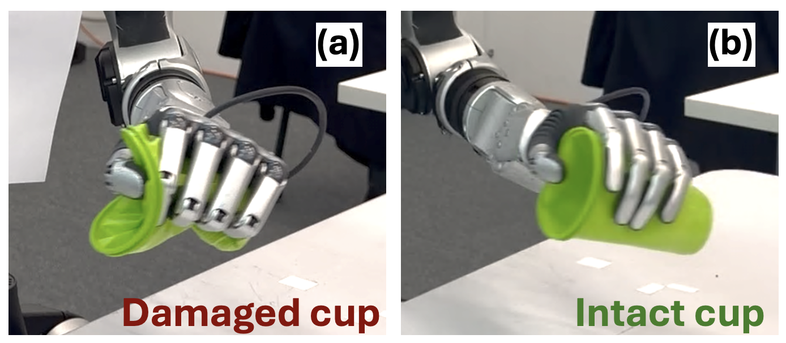
  <br>
  <em>Cup outcomes: damage under position control, intact under compliant control (Fig. 4 of the paper).</em>
</p>

**Timing matters.** The compliant branch starts only while the hand is still
open (measured mean flexion below 0.45). The hand is first opened fully, then
handed to the compliant hand service, which closes and holds. If the compliant
decision arrives after the hand has already closed, the handover is not started
and the grasp stays on the position path; the log shows `COMPLIANT_TOO_LATE`.
This is the failure seen in the one damaged VLM-only trial of the table above,
where compliant mode was selected after closure had begun and the damage was
not prevented.

The clips below show the same contrast in motion: under position control the
cup collapses in the hand, under compliant control it keeps its shape.

<table>
  <tr>
    <td align="center">
      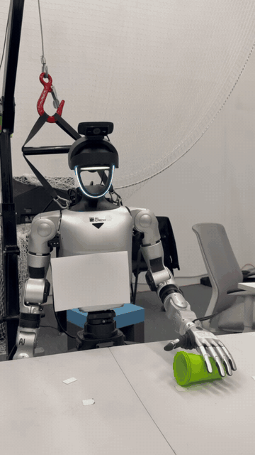
      <br><em>Position control: the cup is crushed. Real time.</em>
    </td>
    <td align="center">
      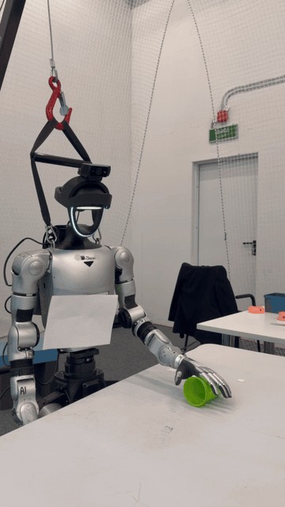
      <br><em>Compliant mode: the cup stays intact. Speed-ramped, trimmed to 8 s.</em>
    </td>
  </tr>
</table>

Compliant control covers closure and holding only, not autonomous transport.
Details of the handover: [docs/deployment.md](docs/deployment.md).

## 5. Hardware and software requirements

| Item | Requirement |
|---|---|
| Robot | Unitree G1 humanoid |
| Hand | BrainCo Revo2, six motor channels, positions normalized to [0, 1], no touch sensors |
| Policy | GR00T-N1.6-3B fine-tuned on teleoperated demonstrations, served by the Isaac-GR00T policy server |
| Whole-body control | GEAR-SONIC (GR00T-WholeBodyControl) |
| VLM, optional | Qwen2.5-VL-7B-Instruct on a GPU server |
| Python | 3.10 or newer |
| Core package | `numpy` |
| Robot side | `pyzmq`, `msgpack`, `tyro`, `opencv-python`, plus `gear_sonic` and `unitree_sdk2py` from their own repositories |
| Compliant hand service | C++17 compiler, CMake, the BrainCo Stark SDK |
| VLM service | `torch`, `transformers`, `accelerate`, `pillow`, `pyzmq` |
| Analysis | `pandas`, `matplotlib` |

The supervisor logic, the tests and the analysis scripts run on any computer.
Only the bridge needs the robot.

## 6. Installation

```bash
git clone https://github.com/eliizavetas/agentic-tactile-vla.git
cd agentic-tactile-vla
python -m venv .venv && source .venv/bin/activate
pip install -e ".[analysis,dev]"
pytest
```

On the robot, inside the GR00T-WholeBodyControl data-collection environment:

```bash
pip install -e ".[robot]"
cp .env.example .env    # fill in the addresses, then: set -a; source .env; set +a
```

On the GPU server, for the VLM service: `pip install -e ".[vlm]"`.

## 7. Running it

### What you need to bring

This repository contains the supervisor and its glue code. The rest of the
stack comes from elsewhere.

* **A policy checkpoint.** GR00T-N1.6-3B fine-tuned for this embodiment. The
  checkpoint used in the paper and the teleoperation dataset it was trained on
  are not released. To make your own, collect teleoperated demonstrations on
  your robot and fine-tune with
  [Isaac-GR00T](https://github.com/NVIDIA/Isaac-GR00T), using the modality
  config in [`configs/tactile_g1_config.py`](configs/tactile_g1_config.py)
  (action horizon 50) and the embodiment tag `NEW_EMBODIMENT`:

  ```bash
  # GPU server, in the Isaac-GR00T checkout
  bash examples/finetune.sh \
    --base-model-path <path to the base GR00T-N1.6-3B model> \
    --dataset-path <path to your dataset> \
    --embodiment-tag NEW_EMBODIMENT \
    --modality-config-path <path to this repository>/configs/tactile_g1_config.py \
    --output-dir <checkpoint directory>
  ```

* **Policy server:** [Isaac-GR00T](https://github.com/NVIDIA/Isaac-GR00T), on
  the GPU server.
* **Whole-body controller and camera server:**
  [GR00T-WholeBodyControl](https://github.com/NVlabs/GR00T-WholeBodyControl)
  (GEAR-SONIC), on the robot. The bridge runs inside its data-collection
  environment and imports its `gear_sonic` package.
* **Hand DDS bindings:**
  [unitree_sdk2_python](https://github.com/unitreerobotics/unitree_sdk2_python),
  importable in the same environment.
* **Hand service:** the `brainco_hand_server` binary is built from Unitree's
  [brainco_hand_service](https://github.com/unitreerobotics/brainco_hand_service),
  which converts the hand's serial protocol to the `rt/brainco/*` DDS topics.
* **Stark SDK, only for the compliant driver:** `stark-sdk.h` and
  `libbc_stark_sdk.so` from BrainCo. They ship inside the Unitree
  brainco_hand_service repository (`include/` and `lib/<architecture>/`);
  BrainCo's own examples are at
  [stark-serialport-example](https://github.com/BrainCoTech/stark-serialport-example).

### Launch order

Start the processes in this order. Each step names the machine and the
directory it runs in. Full details and troubleshooting are in
[docs/deployment.md](docs/deployment.md).

**Step 1, policy server. Machine: GPU server. Directory: the Isaac-GR00T
checkout, with its environment active. Wait for "Server is ready".**

```bash
python gr00t/eval/run_gr00t_server.py --model-path <checkpoint> \
  --embodiment-tag NEW_EMBODIMENT --port 5555
```

**Step 2, port forward. Machine: GPU server host. Directory: any. Only if the
policy server runs in a container.**

```bash
socat TCP-LISTEN:5555,fork,reuseaddr TCP:<container address>:5555
```

**Step 3, camera. Machine: robot. Directory: the GR00T-WholeBodyControl
checkout, with its camera environment active.**

```bash
python -m gear_sonic.camera.composed_camera --ego-view-camera usb \
  --ego-view-device-id <video device id> --port $CAMERA_PORT
```

**Step 4, hand service. Machine: robot. Directory: the brainco_hand_service
checkout. Exactly one instance.**

```bash
sudo ./bin/brainco_hand_server -n $HAND_IFACE
```

**Step 5, whole-body controller. Machine: robot. Directory:
`gear_sonic_deploy` inside the GR00T-WholeBodyControl checkout. Wait for
"Init done". The robot stands up.**

```bash
cd ~/GR00T-WholeBodyControl/gear_sonic_deploy && source scripts/setup_env.sh
./deploy.sh --input-type zmq_manager real
```

**Step 6, keyboard publisher. Machine: robot. Directory: this repository, with
the GR00T-WholeBodyControl data-collection environment active. Exactly one
instance.**

```bash
python scripts/keyboard_publisher.py
```

**Step 7, bridge with the supervisor. Machine: robot. Directory: this
repository, same environment as step 6. Wait for "PolicyServer is reachable".**

```bash
HAND_ENABLE=1 SLEW_ENABLE=1 python scripts/run_agent.py --hand left \
  --embodiment-tag NEW_EMBODIMENT --prompt "pick up the object and place it down"
```

* `HAND_ENABLE=1` sends hand commands to the hand; without it they are only
  printed (dry run).
* `SLEW_ENABLE=1` caps the per-tick change of the body token and of the nominal
  hand command, which smooths jumps between consecutive action chunks.

The instruction must match the task prompt your checkpoint was trained with,
character for character. The policy is conditioned on that exact string, and a
different wording is an input it was never trained on. The prompt above is the
one stored in the recorded logs under `data/raw/`; replace it with your own
checkpoint's training prompt. To request careful handling, do not edit the
prompt. Pass `--handling-cue gently` instead, which reaches only the
supervisor.

Then press `k`, `i`, `p` in the keyboard publisher. Use `--no-agent` for the
base VLA and `--observe` to log supervisor decisions without acting on them.

**Optional step A, automatic mode selection. Machine: GPU server for the
service, robot for the tunnel. Directory: this repository.** Start the VLM
service on the GPU server, open a tunnel from the robot to it, and add `--vlm`
to step 7. See "Optional: VLM service" in
[docs/deployment.md](docs/deployment.md).

```bash
python scripts/vlm_service.py --port 5599              # GPU server
ssh -N -L 5599:localhost:5599 <user>@<GPU server>      # robot, then VLM_HOST=localhost
```

**Optional step B, fragile objects. Machine: robot. Directory: this
repository.** Build the compliant hand service, record its gate files, and
start step 7 with `COMPLIANT_DRIVER=1`. See "Compliant mode on hardware" in
[docs/deployment.md](docs/deployment.md).

## 8. Configuration

All thresholds live in [`src/agentic_tactile_vla/config.py`](src/agentic_tactile_vla/config.py).

| Parameter | Paper symbol | Default | Controls |
|---|---|---|---|
| `control_period` | 50 Hz | 0.02 s | rate of finger references |
| `arm_delta`, `arm_window` | | 0.015, 0.25 s | flexion-target advance that arms a closure |
| `terminal_delta`, `terminal_window` | | 0.005, 0.12 s | target variation below which the closure is finished |
| `min_support` | 3 in eqs. (3), (8) | 3 | supports needed to stay transparent and for FORMED |
| `window` | W | 0.25 s | detector history window |
| `delta_u` | δ_u | 0.015 | minimum commanded advance over W |
| `rho_s` | ρ_s | 0.3 | tracking ratio for position stall |
| `rho_d` | ρ_d | 0.7 | tracking ratio for the effort-duration test |
| `delta_e` | δ_e | 0.3 | effort deviation from the ADJUST baseline, device units |
| `t_e` | T_e | 0.06 s | required duration of the effort deviation |
| `step`, `step_period` | | 0.004, 0.02 s | correction increment |
| `preload` | | 0.02 | added to the measured position when support latches |
| `min_adjust`, `max_adjust` | | 0.6 s, 4.0 s | bounds on the adjustment phase |
| `reopen_delta`, `reopen_hold` | | 0.05, 0.12 s | drop in mean flexion that releases a hold and allows rearming |
| `travel_limit` | permitted travel limit | 0.98 on flexion channels | upper bound of each finger reference; not reported in the paper, taken from the teleoperation closed-hand preset |
| `selective`, `use_effort`, `verdict_release`, `use_verdict` | S / U variants | all true | ablation switches |
| `CompliantConfig.kp`, `kd` | K_p, K_d | 5.0, 0.05 | controller-interface gains, not stiffness or damping |
| `CompliantConfig.period` | | 0.02 s | compliant loop period |
| `CompliantConfig.i_max` | I_max | 0.15 | normalized command limit; raw 150 → 0.15, raw 200 → 0.20; not calibrated current |
| `CompliantConfig.preopen`, `early_max_flexion`, `min_hold` | | 0.8 s, 0.45, 8.0 s | compliant handover: pre-open time, flexion level below which the branch may start, minimum hold; not reported in the paper |
| `max_state_age` | | 0.5 s | hand state older than this is not acted on outside the compliant branch; not reported in the paper |
| `CompliantConfig.velocity_alpha` | | 0.3 | velocity smoothing factor; not reported in the paper |
| `CompliantConfig.target` | q_d | per channel | predefined grasp configuration; not reported in the paper |
| `ModeConfig.handling_cues` | | gently, carefully, fragile | words that select compliant mode |

Detector thresholds were selected from 40 calibration closures on the five
training objects and frozen before evaluation. Do not tune them on evaluation
objects.

## 9. Repository layout

```
agentic-tactile-vla/
├── src/agentic_tactile_vla/   library: supervisor, detector, correction, verdict, modes, compliant control, hand interface
│   └── bridge/                robot-side integration with the GR00T bridge, policy client, patch notes
├── scripts/                   entry points: robot launcher, keyboard publisher, VLM service, log replay
│   └── figures/               figure script that reads the recorded logs
├── analysis/                  statistics from the published counts, eq. (8) on recorded flags, retention audit
├── drivers/brainco_compliant/ current-mode hand service for the compliant branch (C++), gate diagnostics, clients
├── configs/                   GR00T modality config used for fine-tuning
├── tests/                     unit tests on a simulated finger model
├── data/raw/                  August development logs, unchanged
├── data/processed/            per-attempt and summary tables from the same sessions
├── docs/                      architecture, detector, deployment, experiments, data formats
│   └── media/                 paper figures and short clip previews used in this README
└── paper/                     paper PDF and LaTeX source
```

## 10. Reproducing the analysis

Per-trial records for the evaluation tables are not part of this release.
`data/raw/` contains August development logs recorded with an earlier version
of the supervisor; they document the log format and can be replayed through
the detector, but do not reproduce the paper's tables.

What can be run:

| Command | What it gives |
|---|---|
| `python analysis/paper_statistics.py` | Wilson intervals, exact McNemar and Holm p-values and derived rates for Tables II to V, computed from the counts printed in the paper |
| `python analysis/retention_audit.py --counts 70 6 18 26` | rates of the retention table from its four cells |
| `python analysis/compute_verdicts.py data/raw/verdicts_left_*.csv` | the verdict rule of eq. (8) applied to the recorded per-finger flags |
| `python scripts/replay_logs.py data/raw/ramp_left_*.csv` | the detector of this repository replayed over recorded correction episodes |
| `python scripts/figures/fig_event.py data/raw/ramp_left_20260819_022049.csv -a 9` | plot of one recorded correction event |
| `pytest` | unit tests of the state machine, detector, correction, mode selection and compliant law |

How each table was produced is described in
[docs/experiments.md](docs/experiments.md).

## 11. Limitations

* **Proprioception is not calibrated force.** Positions and motor effort are
  device-specific signals. Thresholds do not transfer to another hand without
  recalibration.
* **Highly compliant objects defeat the motion-based cue.** The soft ball
  produced zero FORMED verdicts in six correction events although it was
  physically enclosed every time.
* **Rejection is conservative.** In the retention audit the NPV is 59.1%
  pooled, and on held-out objects 25.6% of retainable configurations were
  falsely rejected. Acceptance is the reliable direction.
* **The fragile-object study used a training object.** It does not show
  held-out fragile-object generalization, and routing did not beat
  always-compliant control.
* **Compliant control covers static grasping only.** Closure and holding, no
  autonomous transport.
* **The supervisor cannot recover from arbitrary approach errors.** It adapts
  a feasible policy-generated grasp; it does not replace the approach.
* **Some effects are not statistically resolved.** The separate contributions
  of effort evidence and verdict-dependent release are not isolated by the
  ablation, and no difference between selective and always-on supervision was
  detected, which is not proof of equivalence.
* **This code has not been run on the robot.** See the status note at the top.
  The compliant hand service in `drivers/` needs gate files recorded on your
  own hand before it starts, and it contains safety logic beyond equation (9),
  such as a closing-speed cap, that the paper does not describe.

## 12. Citation

```bibtex
@misc{semenyakina2026agentictactilevla,
  title  = {AgenticTactileVLA: Contact-Guided Execution-Time Supervision for
            Generalizable Dexterous Manipulation without VLA Retraining},
  author = {Semenyakina, Elizaveta and Snegirev, Ivan and Kiselev, Mikhail and
            Altamirano Cabrera, Miguel and Lykov, Artem and Amjad, Hajira and
            Tsetserukou, Dzmitry},
  year   = {2026},
  note   = {Manuscript}
}
```

## License

MIT, see [LICENSE](LICENSE). The bridge file derived from
GR00T-WholeBodyControl stays under Apache-2.0; see
[src/agentic_tactile_vla/bridge/NOTICE](src/agentic_tactile_vla/bridge/NOTICE).
