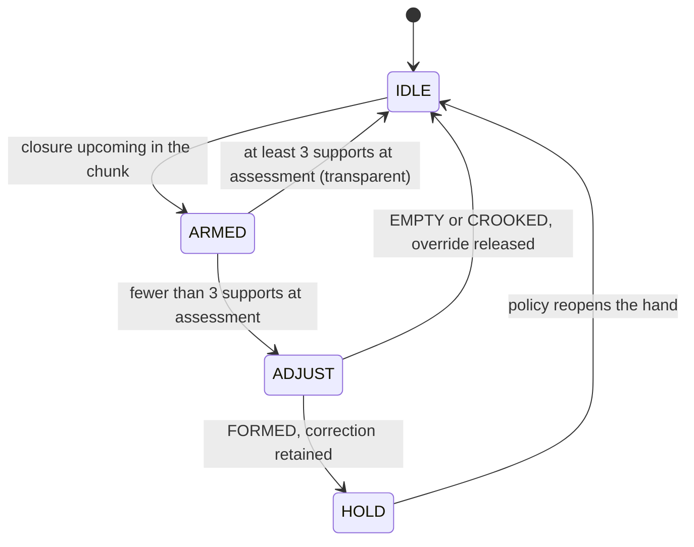

# Architecture

AgenticTactileVLA wraps a fixed vision-language-action (VLA) policy with an
execution-time supervisor. The policy predicts the manipulation strategy. The
supervisor adapts how that strategy is physically realized by the hand, using
only signals the hand already publishes.

Section numbers refer to the paper in `paper/`.

## Components

| Component | Role | Code |
|---|---|---|
| GR00T-N1.6-3B, fine-tuned, fixed | emits action chunks: body-motion tokens `z` and nominal hand targets `u` in `[0,1]^6` | external; `configs/tactile_g1_config.py` |
| GEAR-SONIC whole-body controller | realizes the body-motion tokens, keeps the robot stabilized | external |
| BrainCo Revo2 hand | executes hand targets, publishes positions `q` and a motor-effort proxy `e` | `hand.py` |
| Execution supervisor | state machine that decides who controls the hand and whether the body reference advances | `supervisor.py` |
| Closure detector | finds arming and the terminal phase in the action chunk | `closure.py` |
| Contact detector | per-finger support latches from position stall and sustained effort | `contact.py` |
| Finger corrector | per-finger advance, preload and timing bounds | `correction.py` |
| Verdict | FORMED, EMPTY or CROOKED from the support count | `verdict.py` |
| Mode selector | nominal or compliant control from language cues and a VLM | `modes.py`, `vlm_client.py`, `scripts/vlm_service.py` |
| Compliant controller | current-limited PD law | `compliant.py` |
| Bridge | connects all of the above on the robot | `bridge/vla_bridge.py` |

The policy is never retrained by this project and is not modified at run time.

## Hand channels

| Index | Channel | Monitored by the supervisor |
|---|---|---|
| 0 | thumb flexion | yes |
| 1 | thumb opposition | no, always the policy target |
| 2 | index | yes |
| 3 | middle | yes |
| 4 | ring | yes |
| 5 | little | yes |

Thumb opposition sets the grasp arrangement the policy selected. The
supervisor never changes it.

## Supervisor interface

Each control tick (50 Hz) the supervisor maps

```
(action chunk A_t, history H_t, instruction, image, state)  ->  (mode m_t, intervention, references r_t, body gate b_t)
```

In code this is `ExecutionSupervisor.step(...)` returning a `SupervisorOutput`:

| Field | Meaning |
|---|---|
| `state` | IDLE, ARMED, ADJUST or HOLD |
| `hand_target` | the six position references to issue this tick |
| `override` | the supervisor replaces the nominal hand target |
| `body_gate` | `b_t`; 1 pauses progression of the body reference |
| `mode` | nominal or compliant |
| `compliant_active`, `compliant_command` | compliant branch engaged, and its current-limited command |
| `authority_transition` | the caller must discard queued chunks and re-infer |
| `episode` | summary of an assessed closure, on the tick it closes |

## State machine

| State | `b_t` | Override | Exit condition |
|---|---|---|---|
| IDLE | 0 | no | upcoming closure appears in the action chunk |
| ARMED | 0 | no | terminal grasp assessment reached |
| ADJUST | 1 | yes | grasp verdict or timeout |
| HOLD | 0 | yes | policy reopens the hand |



**IDLE.** The nominal target passes through. While the hand is open, one VLM
request per grasp episode may be started. The state is left when any flexion
target advances by 0.015 over 0.25 s.

**ARMED.** The nominal target still passes through. Position-support evidence
accumulates. The interaction mode is fixed at arming. The state ends at the
terminal phase: every flexion target varies by less than 0.005 over 0.12 s.
This is the grasp-assessment point.

**Assessment.** Selective intervention is evaluated here and only here:

```
eta_t = g_t * I[ sum over F of c_hat_i(t) < 3 ]
```

With at least three position-support latches the supervisor stays transparent
and never touches the hand. Otherwise it enters ADJUST.

**ADJUST.** `b_t = 1`. Each unsupported finger advances from its measured
position until its support latches or its travel is exhausted. The effort
channel of the detector is active only here. The state lasts between 0.6 s and
4.0 s and ends with a verdict.

**HOLD.** A FORMED correction is retained. The body gate is released, so the
policy continues with transport. The state is left when the policy-commanded
mean flexion drops by at least 0.05 below its value at the terminal assessment
for 0.12 s.

When `b_t = 1` only progression of the body reference is paused. Whole-body
stabilization stays active throughout.

## Verdict and release

| Verdict | Support count | Effect |
|---|---|---|
| FORMED | 3 or more | corrected configuration retained, body gate released |
| EMPTY | 0 | hand override released |
| CROOKED | 1 or 2 | hand override released |

CROOKED means insufficient support evidence. It does not mean geometric
misalignment. Releasing the override does not command reopening: the nominal
policy target simply becomes the hand reference again, and later policy actions
may reopen the hand and approach again.

## Re-entry blocking

Each closure produces at most one correction episode.

* A retained override is released when the policy-commanded mean flexion stays
  at least 0.05 below its terminal-assessment value for 0.12 s.
* Rearming additionally requires both the commanded and the measured mean
  flexion to stay at least 0.05 below their terminal-assessment values for
  0.12 s. Reopening resets all support latches.

## Authority transitions

Hand authority changes on entry to ADJUST, at the verdict and when a retained
override is released. At each of these the output sets `authority_transition`.
The bridge then drops the cached chunk, discards any inference result computed
from an observation taken before the transition and triggers a new inference.
While the new chunk is pending no motion token is sent, so whole-body
stabilization holds the current body reference. The corrected hand state is
part of the fresh observation, so it conditions the next policy chunk.

## Interaction modes

Two predefined modes exist: nominal position control and compliant control.

1. An explicit handling cue in the instruction ("gently", "carefully",
   "fragile") selects compliant mode.
2. Without a cue, Qwen2.5-VL-7B-Instruct selects between the two modes from the
   image and the task. It runs asynchronously while the hand is open, and one
   decision is cached per grasp episode.
3. Language cues take priority. A missing, late or malformed VLM reply gives
   nominal control.

The VLM selects only the mode. It does not estimate material properties and
does not produce controller parameters. The reply parser accepts exactly the
two labels `nominal` and `compliant`; any other reply is malformed. The VLM is
given the task text with the handling cues removed.

The mode is chosen before closure because a fragile object may deform before
proprioceptive resistance becomes detectable.

## Compliant controller

```
I_cmd_i(t) = sat_[-I_max, I_max]( K_p * [q_d_i(t) - q_i(t)] - K_d * qdot_smooth_i(t) )
```

`K_p = 5.0`, `K_d = 0.05`, period 20 ms. These are controller-interface gains,
not physical stiffness or damping. Raw command limits of 150 and 200 map to
`I_max = 0.15` and `0.20`. These are device-level actuator commands, not
calibrated motor current. The controller covers compliant closure and holding,
not autonomous transport.

## Points the paper leaves open

The paper fixes the rules above. A few details needed for a running system are
not stated in it. They are listed here so that they are not mistaken for
reported parameters.

| Detail | Choice in this repository |
|---|---|
| Buffer for closure detection | Arming looks ahead in the chunk over 0.25 s, with the issued targets as fallback. The terminal phase uses the targets issued over the trailing 0.12 s. |
| Pairing of command and measurement | The detector pairs the position measured now with the reference issued on the previous tick. |
| ARMED without an assessment | If the policy reopens before the terminal phase, or the announced closure disappears from the chunk, the supervisor returns to IDLE. |
| Numeric travel limits | Not reported. `travel_limit` defaults to 1.0 per channel and must be set for the hand in use. |
| Velocity smoothing factor | Not reported. `velocity_alpha = 0.3`. |
| Compliant grasp configuration | Not reported. `CompliantConfig.target` holds a default to be set per grasp. |
| Compliant branch in the state table | Realized as HOLD with the compliant controller engaged at arming; left when the policy reopens the hand. |
| Ablation variants | U-stall, U-full, S-position, S-retain and S-full are switches in `config.py`, written from their description in Sec. IV-C. |
